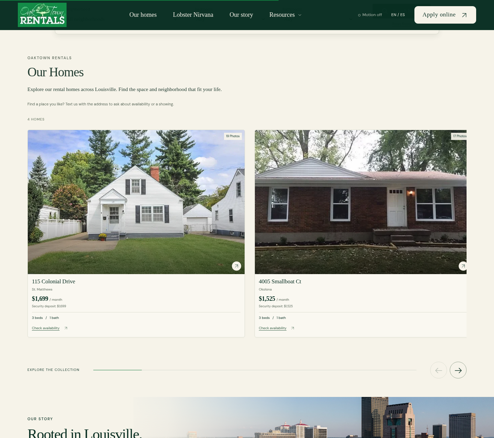
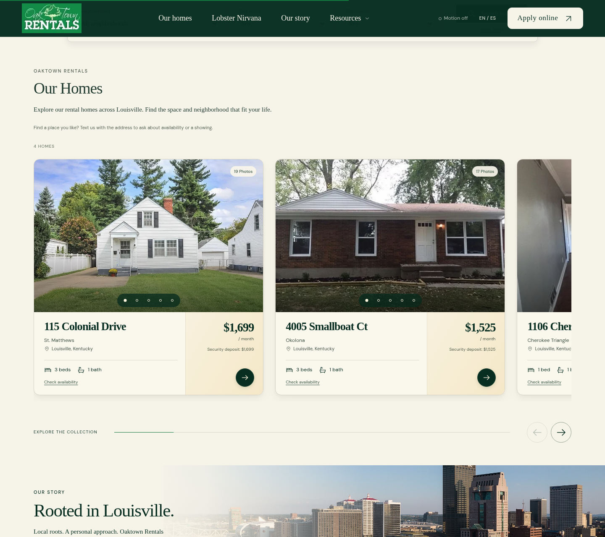
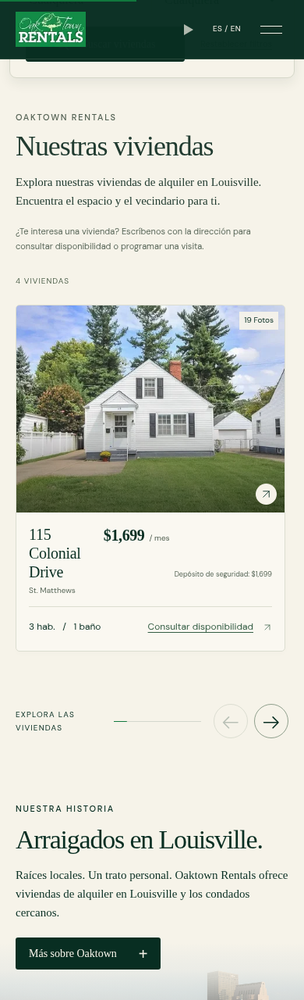
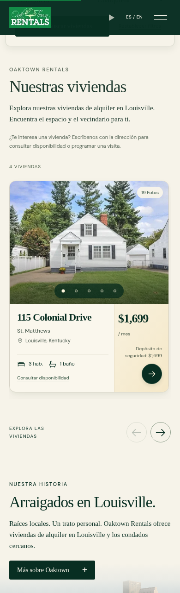

# Phase 2C — Boutique Luxury ready for visual acceptance

Ravi continued Felix's `7ff126e` on existing draft [PR #26](https://github.com/huzshk0707/oaktown-rentals-website/pull/26). Option B is implemented: generous **38vw desktop cards**, ivory surfaces, champagne pricing rail, serif addresses, verified facts, minimal icons and a functional green detail arrow. The full-width introduction and single horizontal gallery remain. The cinematic hero only changes its approved scene-two sentence in English and Spanish.

**[Open the preview](https://felix-oaktown-signature-oaktown.rentals10.workers.dev/#homes)** · [Exact approved reference](approved-option-b.png) · [Reference provenance](REFERENCE.md) · [Interaction recording](boutique-interactions.webm).

## Reference and before/after comparison

The lower Option B inset is the styling authority. The implementation retains its ivory/champagne division, serif hierarchy, fine border, rounded corners, subtle shadow, photographic emphasis and green circular action. The owner's explicit 38vw sizing and existing photo ratios govern proportions. Genuine full addresses, rents, deposits, neighborhoods, specifications and the original logo replace all fictional reference content. No favorite heart or unverified Ready Now badge was added.

| Before: generous Phase 2A foundation, verified in Phase 2B | After: approved Boutique treatment |
| --- | --- |
|  |  |
|  |  |

Visual review checked the approved reference against actual desktop cards, the right-boundary Cherokee #8/Madison cards, tablet Spanish, narrow 320px Spanish, a stationary single result, and both hero translations. The pricing rail stays distinct without overpowering the photo. Long Spanish labels and full unit addresses wrap without colliding with controls. Stronger focus outlines were added around the circular action and photo buttons. Manual photo crossfades retain the previous photo underneath until the selected image is visible, avoiding a flash back to the lead photograph.

## Actual browser evidence

These are real browser screenshots of the branch runtime served locally at `http://127.0.0.1:8930`, with genuine remote CDN photos, normal TLS and **no response/photo substitutions**. Hosted runtime hashes are checked separately in [photo-verification.json](photo-verification.json). Tall 1280px section viewports preserve gallery scroll positions; ordinary 390×844 phone captures are also included. There are 35 screenshots, including three full pages and two animated hero scenes.

| State | Desktop EN | Tablet EN | Mobile EN | Mobile ES |
| --- | --- | --- | --- | --- |
| Full Our Homes / left boundary | [Desktop](desktop-all-left.png) | [Tablet](tablet-all-left.png) | [Mobile](mobile-all-left.png) | [Spanish](mobile-es-all-left.png) |
| All properties / right boundary | [Desktop](desktop-all-right.png) | [Tablet](tablet-all-right.png) | [Mobile](mobile-all-right.png) | [Spanish](mobile-es-all-right.png) |
| One home / Cherokee Triangle | [Desktop](desktop-one.png) | [Tablet](tablet-one.png) | [Mobile](mobile-one.png) | [Spanish](mobile-es-one.png) |
| Two-home **review fixture** | [Desktop](desktop-two-review-fixture.png) | [Tablet](tablet-two-review-fixture.png) | [Mobile](mobile-two-review-fixture.png) | [Spanish](mobile-es-two-review-fixture.png) |

[Desktop Spanish](desktop-es-all-left.png) · [Tablet Spanish](tablet-es-all-left.png) · [320px Spanish](narrow-es-all-left.png) · [320px single result](narrow-es-one.png) · [390×844 EN](phone-844-en.png) · [390×844 ES](phone-844-es.png).

[Full desktop](desktop-full-page.png) · [Full desktop Spanish](desktop-es-full-page.png) · [Full mobile](mobile-full-page.png) · [Hero scene two EN](hero-scene-2-en.png) · [Hero scene two ES](hero-scene-2-es.png).

**Two-result disclosure:** the existing public filter combinations cannot produce exactly two homes. The test browser temporarily adds a combined St. Matthews/Okolona option and invokes the existing pipe-separated filter path. The homes and photos are genuine; no catalogue records or shipped filter options were changed. Both cards remain fixed-width and left-aligned; desktop controls disappear when they fit. At tablet/mobile widths, natural overflow remains scrollable, without edge-driven drift for this small result set.

**[Watch the interaction recording](boutique-interactions.webm)**: actual 1440×1200 browser video shows card hover, manual photo selection, selected-photo expansion to the existing detail page, Back navigation, intentional edge movement and bounded arrows. Decoded with ffmpeg, sampled visually and played in a browser video element; see [playback verification](video-playback.json).

## Interaction conventions

- Shared timing tokens: 160ms immediate/hover feedback, 280ms component fades, 500ms photo hover. The existing 600ms native shared-image route transition remains intact.
- Successful search/reset/photo choices get a brief confirmation pulse; pending image choices immediately expose `aria-busy`, and failed loads retain the prior image and announce the error.
- Five functional photo dots form a sliding window through the genuine ordered gallery; previous/next buttons allow every image to be reached. Manual selection persists while browsing the card. No additional timed gallery scrolling, infinite collection loop or favorites feature.
- The selected photo expands into the detail cover on supported browsers. Unsupported browsers and motion-off navigation render immediately. History restores the horizontal/vertical position and the activating photo/name/detail-link focus.
- Small masked photo/headline reveals, a brief boundary-meter pulse, and the existing focus-managed native gallery dialog use consistent feedback. Photo controls stop edge movement while being operated. Changing play/pause icons retain the existing motion implementation; no unrelated icon system was introduced.
- Circular detail and photo-arrow hit areas are at least 44px tall; photo dots are 28px targets. Bilingual accessible labels, keyboard activation and native mobile swiping remain. Reduced-motion and the manual motion toggle disable collection animations and smooth scrolling.

## Verification

Node 24 and system Chromium. Local browser commands use `OAKTOWN_BASE_URL=http://127.0.0.1:8930`. Admin checks use disposable fixtures, never production mutations. Exact outputs are in [test-results](test-results).

| Command | Result |
| --- | --- |
| `npm run check` | PASS |
| `npm test` | PASS, 8 CMS/security/component groups |
| `node tests/boutique.cjs` | PASS, 7 Boutique groups, including photo errors, same-image routing, focus, reduced motion and translations |
| `node tests/collection.cjs` | PASS, 8 gallery/fit/keyboard/touch/edge/filter groups |
| `node tests/signature.cjs` | PASS, 19 groups |
| `node tests/browser.cjs` | PASS, 45 checks |
| `node tests/design.cjs` | PASS, 33 checks |
| `node tests/browsing.cjs` | PASS, 24 checks |
| `node tests/audit.cjs` | PASS, 15 checks |
| `node tests/motion.cjs` | PASS, 9 groups |
| `npm run test:admin-browser` | PASS, disposable publishing workflow |
| `npm run test:photo-order` | PASS, mouse/touch/keyboard/exact order |
| `npm run test:admin-improvements` | PASS, 6 groups |
| `node tests/mint-mojo.cjs` | PASS |
| `node tests/capture-boutique.cjs` | PASS, 30 measured collection captures plus full pages/hero scenes; 16 axe scans, zero confirmed violations |
| `OAKTOWN_EVIDENCE_DIR=docs/oaktown-signature/phase2c node tests/verify-collection-photos.cjs` | PASS, 60 original files/detail selections, 4 exact catalogue mappings and 7 hosted runtime hashes |

The capture command needs `OAKTOWN_AXE_PATH` pointing at axe-core and Playwright's ffmpeg for video; this workspace used the installed system ffmpeg via `PLAYWRIGHT_BROWSERS_PATH=/tmp/oaktown-boutique-browsers`. No new runtime dependency was added. Behavior-only tests use labelled image fixtures for determinism; screenshot/video evidence never uses them. The existing browser test now waits for asynchronous hero rendering before reading its geometry. The collection endpoint assertion uses actual scroll extent after the approved width reduction.

[Preservation report](preservation.json) records unchanged hero JS/CSS, catalogue, image assets, CMS, admin, authentication, Mint Mojo and deployment configuration relative to Felix's checkpoint. No schema migration, live data change, payment activation or production deployment was performed.

## Limits and exact next step

- Initial workspace CDN restrictions were resolved with an approved narrow environment grant. No current CDN loading blocker remains. No TLS bypass or production/network infrastructure change was used.
- The [Phase 2B original-photo audit](../phase2b/PHOTOGRAPHY.md) still applies: 43/60 originals are only 480–640px wide. Cherokee #8's portrait lead crops vertically in a wide card. Photo enhancement is separately scoped; no houses or unit photographs were invented or replaced.
- Axe leaves image/overlay contrast cases for manual assessment. These checks do not certify full accessibility or performance. Native Safari/Firefox, physical mobile devices, screen-reader sessions and authenticated production admin sign-in were not exercised.
- Original-photo reuse is confirmed; the existing enhanced Afterglow image still requires the owner's separate architectural acceptance before production. This phase preserved it exactly as requested.

**NEXT STEP:** owner/ChatGPT reviews this reference comparison, desktop/mobile Boutique cards, scene-two copy and interaction recording, then provides visual acceptance or specific revisions on PR #26. Keep the PR draft; future sections, merge and production publication need separate direction.
