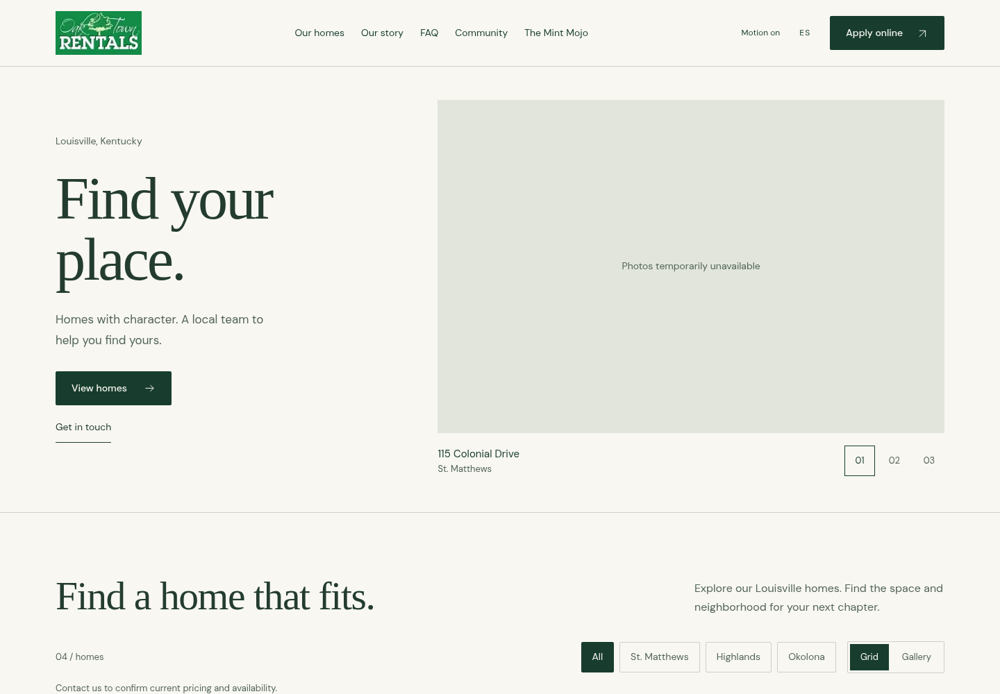
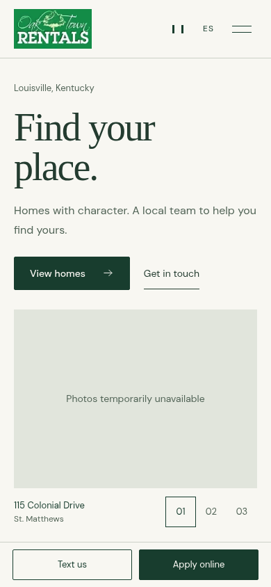

# Oaktown public redesign — PR #8 archive

This document records the original PR #8 review. For the subsequent owner-requested restoration of cinematic motion and brand colors, see [Motion and brand refinement](motion-refinement.md). The statements below describe the original review phase.

This branch improves the existing public site. It is **not deployed or merged**. Real property-photo review and refreshed desktop, tablet and mobile screenshots are complete. The branch is ready for owner review.

## Current-site audit

The before screenshots use current `main` at `d6fee49`, including its footer-wordmark removal. Both designs render the same read-only snapshot of the four currently published properties. These are local comparison captures, not screenshots of a deployed redesign.

**Keep:** original logo and green identity; bilingual property descriptions; complete unit-specific galleries; grid/gallery choice and neighborhood filters; address-specific inquiry/showing links; the existing application URL; CMS-published snapshots, failure handling and private admin boundary. The buildless frontend and local fonts are a good fit for fast delivery.

**Improve:** the 180svh desktop hero postpones browsing and changes content as people scroll; oversized type mixes sans and isolated italic words; nearly every section competes in dark green; photo-overlay titles depend on image contrast; repeated numbered section labels add visual noise. Mobile actions need careful clearance and cards need legible facts rather than decorative treatments. Existing source CSS has accumulated several overriding layers, which should be consolidated separately if the design is accepted, with Mint Mojo regression coverage.

## Implemented direction

A warm, quiet property catalogue with Oaktown green, original photography and original logo. Complete Georgia headings pair with existing self-hosted DM Sans. The hero has stable copy and explicit photo controls, and the collection starts much sooner. Flat photo-led cards separate neighborhood, address, summary, rent and inquiry. Property pages put a clear heading and rental facts before the full-image gallery. FAQ, local resources and contact sections have distinct roles and comfortable reading sizes.

No stock photography, testimonials, metrics, inventory claims or new property facts were introduced. Hero marketing copy was lightly shortened in both languages; property descriptions and records were not edited. A no-JavaScript bilingual contact fallback was added.

[Design system](../../DESIGN.md) · [Resource evaluation](research.md) · [Leslie’s admin proposal](admin-proposal.md) · [Validation and limitations](validation.md)

## Before / after

These refreshed captures include the real published property photography and local Mint Mojo images. All 39 gallery photos decoded, and gallery ownership and order match the current published records. The container browser cannot trust the environment proxy certificate, so source photographs were downloaded through a TLS-verified HTTP client and the same bytes supplied to both local previews. No image edits, stand-ins or production data changes were made. This verifies visual presentation, not uncached browser/CDN performance.

| View | Before | After |
| --- | --- | --- |
| Desktop, 1440 × 1000 | [Before](screenshots/before-desktop.png) | [After](screenshots/after-desktop.png) |
| Mobile, 390 × 844 | [Before](screenshots/before-mobile.png) | [After](screenshots/after-mobile.png) |
| Desktop, full page | [Before](screenshots/before-desktop-full.png) | [After](screenshots/after-desktop-full.png) |
| Mobile, full page | [Before](screenshots/before-mobile-full.png) | [After](screenshots/after-mobile-full.png) |
| Desktop listing | [Before](screenshots/before-desktop-listing.png) | [After](screenshots/after-desktop-listing.png) |
| Mobile listing | [Before](screenshots/before-mobile-listing.png) | [After](screenshots/after-mobile-listing.png) |
| Tablet, 768px | — | [After](screenshots/after-tablet.png) |
| Spanish mobile, 320px | — | [After](screenshots/after-mobile-spanish.png) |

### Desktop after

### Mobile after

## Scope and review

Public edits are `index.html`, `app.js`, `effects.js` and scoped rules in the existing `brand.css`. Tests and review documents accompany them. `/admin/`, `cms/`, `cms-client.js`, `data.js`, migrations, original media, Workers bindings, Access settings, secrets and deployment configuration are unchanged. Mint Mojo retains its existing styling because the new rules require the public catalogue's body class.

The intended PR targets `main` from `design/premium-oaktown`. Merging and production deployment require owner approval. The original network blocks are resolved. The PR includes the full audit, resource evaluation, screenshots and admin proposal.
