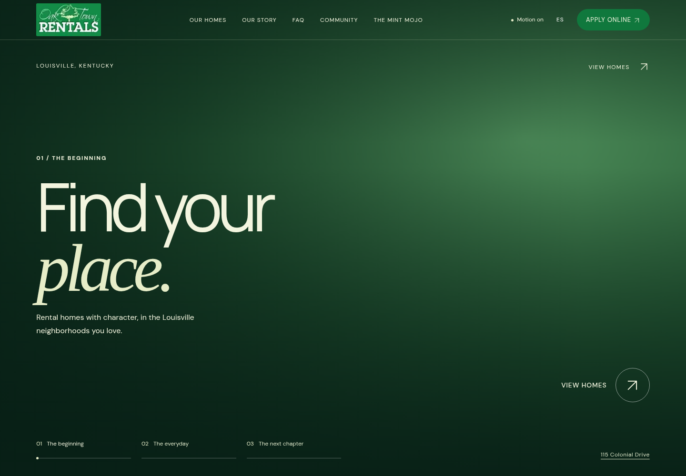
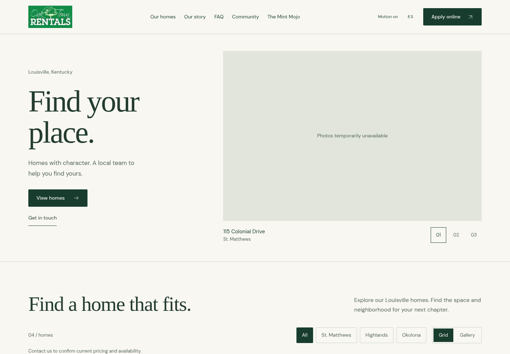
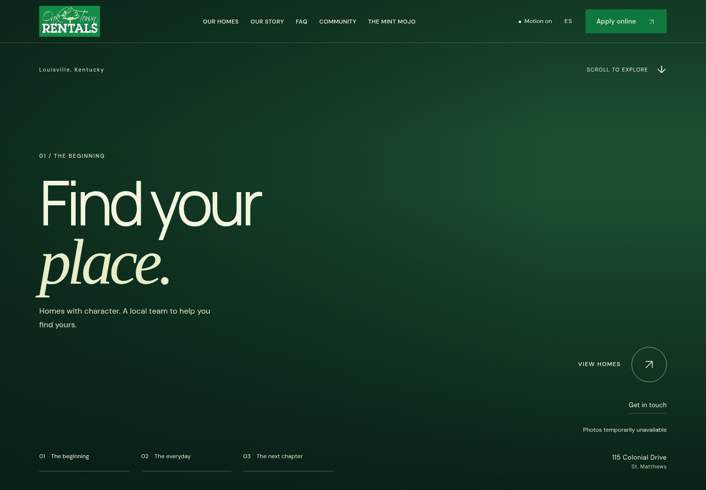

# Cinematic restoration — PR #9 review

[Interactive comparison viewer](index.html) · [Every capture](capture-index.md) · [Capture provenance](fallback/manifest.json) · [Accessibility results](accessibility.json)

This updates the existing `design/restore-oaktown-motion` branch and PR #9. No merge or deployment was performed.

## History and chosen direction

The actual source and PR metadata for #1, #2, #8 and #9 were inspected, including `cinematic.css`, `effects.js`, `app.js` and the retained screenshots. The preferred comparison baseline is the website immediately before PR #8, which includes PR #2's compact motion plus the subsequent original-brand updates.

| Version | Source | Finding |
| --- | --- | --- |
| PR #1 | `4953cc3` | Three scroll-linked chapters, a separate photo-filled O portal and perspective browsing. The 280svh story plus 190svh portal put homes 4.7 screens down. |
| PR #2 | `d947b0f` | Moved the O into the story, shortened the opening to 180svh, restored the labeled mobile action and made a two-column comparison grid the default. This is the motion baseline. |
| Preferred pre-#8 website | `d6fee49` | PR #2's experience with the original forest/sage/cream branding, original JPG logo, later property/admin integration and the removed footer wordmark. |
| Merged PR #8 | `1a21d01` | A static pale catalogue with manually selected hero photos, complete editorial headings and improved rental information. The O, scroll chapters and gallery perspective were removed. |
| PR #9 starting point | `32a568d` | Reintroduced dark colors and chapters, but omitted the O, moved the principal action left, and lost the italic second/third-chapter composition. |
| Refined PR #9 | Runtime hashes in the manifest | Restores the earlier composition, italic chapter phrases, right-side action and contained O, with clearer tablet prices, aligned card facts and carefully bounded motion. |

## Critical visual review and refinements

The fresh screenshots were reviewed against the historical real-photo references and the three fresh local versions. Specific decisions:

- **Composition:** restore the large left-aligned headline, full-bleed photograph, original italic phrases in all three chapters, and right-side View Homes action with the circular arrow. Tablet/phone actions flow beneath the copy. The photo overlay is less heavy than the first restoration attempt, while the left/bottom shades protect the text.
- **O transition:** retain PR #2's branded photographic bridge inside the existing hero rather than reintroducing PR #1's long portal. It sits behind the shade and copy, reuses the third chapter image's exact loaded responsive URL, and is suppressed until that authentic image decodes. It is disabled for mobile/short windows, Motion off and reduced motion. Its geometry and decoded-image gating are tested; its final photographic appearance remains unverified because the source photos are blocked.
- **Rental browsing:** comparison-card facts now share a row baseline. Tablet prices have their own line so addresses can use the full card width. The default grid, filters, complete galleries, property-specific showing links and application URL remain intact. Gallery perspective clears when switching to Grid or disabling motion and recalculates after filtering.
- **Section flow:** retain cream editorial/contact sections between the forest-green areas. The original image collage gets a small, clipped, desktop-only photographic drift; text remains stationary. Reveals and hover transitions respect the motion preference.
- **Mobile:** retain simple navigation and the fixed Text/Apply actions. English/Spanish copy, chapter navigation and hero actions clear one another at short-phone sizes. Motion off also disables smooth anchor navigation.
- **Capture quality:** offscreen content is revealed by normal scrolling before full-section screenshots. Full-page captures reset to the opening chapter. Full-document desktop stills include the green sticky-scroll travel area; during actual scrolling the hero remains pinned in the viewport, rather than exposing a blank screen.

The optional [Vercel Web Interface Guidelines](https://github.com/vercel-labs/web-interface-guidelines/blob/main/command.md) informed the focus, native-control, reduced-motion and cached-geometry review. The earlier [Hallmark/Impeccable evaluation](../research.md) remains a heuristic reference; this work does not claim certification from either tool.

## Fresh screenshots: explicitly fallback

There are **93 actual browser screenshots**, 31 for each version. English includes opening/second/third chapters, collection, property details and gallery at desktop 1440 × 1000, tablet 768 × 1024 and mobile 390 × 844. Desktop includes the O-transition time window. Full-page captures cover desktop/mobile; Spanish adds desktop/tablet opening/details and the complete short-phone sequence at 320 × 640, including collection and full page.

| Desktop opening — fallback | Merged catalogue — fallback | Refined PR #9 — fallback |
| --- | --- | --- |
|  |  |  |

These are local renders, **not live-site captures or final photographic verification**. The running environment returns a destination-policy denial for the public Worker and the external property-photo CDN. No TLS checks were disabled and no replacement property photos were introduced. Each version uses the unchanged repository records. Original photo URLs/order, decoded local logo and Mint Mojo imagery are retained.

The refined O is intentionally absent from the fresh fallback screenshot: showing a solid fake letter when its photograph fails would misrepresent the effect. The older version's O-window screenshot shows its legacy solid fallback. The separate decoded-image test uses the original logo as an isolated readiness fixture; it is never included in comparison screenshots or shipped as a property photograph.

The manifest records locale, viewport, state, image failures, page errors, overflow and source fingerprints. Older/merged refs are exact. The improved base ref identifies the starting checkout; its runtime SHA-256 values identify the captured refinements. The capture runner rejects a runtime change during a capture pass. All 93 captures report zero page errors and no horizontal document overflow.

### Historical authentic-photo references — separate evidence

These retained PR #8 review captures are unchanged and show the real photographs. They establish the earlier compositions, **not acceptance of the refined PR #9's new crops or overlays**.

| View | Older cinematic | Merged catalogue |
| --- | --- | --- |
| Desktop hero | [Original real-photo capture](../screenshots/before-desktop.png) | [Original real-photo capture](../screenshots/after-desktop.png) |
| Mobile hero | [Original real-photo capture](../screenshots/before-mobile.png) | [Original real-photo capture](../screenshots/after-mobile.png) |
| Desktop details | [Original real-photo capture](../screenshots/before-desktop-listing.png) | [Original real-photo capture](../screenshots/after-desktop-listing.png) |

## Verification

| Check | Result |
| --- | --- |
| Public browser suite | 46 checks passed |
| Supplemental bilingual design suite | 35 checks passed |
| Motion suite | 31 checks passed |
| New cinematic suite | 18 checks passed: O decode/failure guards, preference changes, no idle animation frame loop, cached scroll geometry, filtered gallery boundaries, row alignment and non-animated navigation when Motion off |
| CMS/security | 3 tests passed |
| Mint Mojo regression | Passed: photos, galleries, inquiries/dates, navigation, motion, EN/ES and six widths |
| Existing admin workflow, disposable local harness | Passed; no production mutations |
| Axe-core 4.11.0 | 0 confirmed A/AA violations across 12 opening/detail cases in EN/ES at desktop/tablet/phone widths; eight cases retain incomplete contrast results (one home node or two gallery nodes). These are not converted to passes. |
| Syntax, whitespace, Worker dry-run | Passed; dry-run is a build check only |
| Comparison viewer | Three versions, locale/device/state controls, screenshot decoding and O provenance checked in the browser |
| Protected-system source comparison | No changes to admin, CMS, data records/adapter, original assets, Mint Mojo, Cloudflare configuration, headers, root dependencies or publication configuration |

The O adds no animation package, generated frames, timer or new photo source. Rendering uses cached geometry, transform/opacity updates and one frame scheduled by input/layout changes. Live LCP, photo transfer, mobile GPU behavior and native Safari/Firefox acceptance are not established by the local fallback checks.

## Reproduce or replace with real-photo captures

Export `d6fee49` and `1a21d01` into separate scratch directories. Serve those on 8791 and 8792, and this PR checkout on 8793, using ordinary static HTTP servers. Then:

```sh
OAKTOWN_BASE_URL=http://127.0.0.1:8793 npm --prefix tests run test:browser
OAKTOWN_BASE_URL=http://127.0.0.1:8793 npm --prefix tests run test:design
OAKTOWN_BASE_URL=http://127.0.0.1:8793 npm --prefix tests run test:motion
OAKTOWN_BASE_URL=http://127.0.0.1:8793 npm --prefix tests run test:cinematic
OAKTOWN_CAPTURE_MODE=fallback npm --prefix tests run capture:comparison
node tests/build-comparison.cjs
```

Base URLs can be overridden with `OAKTOWN_COMPARE_OLDER_URL`, `OAKTOWN_COMPARE_MERGED_URL` and `OAKTOWN_COMPARE_IMPROVED_URL`. `OAKTOWN_COMPARE_ONLY=improved` refreshes just the improved version; `OAKTOWN_COMPARE_FULL_ONLY=1` refreshes full-page captures. `OAKTOWN_CONTENT_SNAPSHOT` optionally supplies one shared read-only public API snapshot to all three versions.

When access is available, set `OAKTOWN_CAPTURE_MODE=real` and provide `OAKTOWN_PHOTO_MANIFEST` mapping original source URLs to TLS-verified local files with `path` and `contentType`, as in the prior capture workflow. Real mode refuses missing or undecodable images and writes to a separate `real/` directory. Do not relabel the fallback set as photographic acceptance. Owner review with the original photos loading is still required before production approval.
